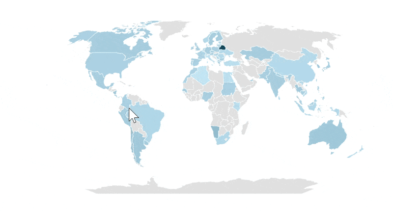
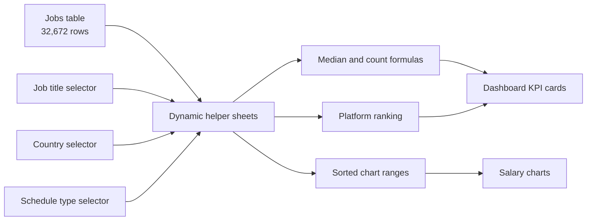

# Data Science Salary Dashboard in Excel


An interactive Excel dashboard that helps job seekers compare salaries across data roles, countries, and employment types. Users select a job title, country, and schedule type to update salary comparisons, geographic patterns, job-platform results, and headline metrics.


## Project Overview

The project turns a 2023 data-jobs dataset into a focused salary research tool. Instead of searching a large table manually, users can answer questions such as:

1. What is the median salary for my target role?
2. How does that role compare with other data careers?
3. How do salaries vary by country?
4. Does employment type affect median pay?
5. Which job platform contains the most matching postings?
6. How many postings match the selected filters?

The workbook combines a presentation-ready dashboard with a structured source table and hidden calculation sheets that keep the interface uncluttered.

## Results at a Glance

| Metric | Result |
|---|---:|
| Job postings analyzed | 32,672 |
| Records with an annual salary | 22,036 |
| Standardized job categories | 10 |
| Countries represented | 111 |
| Overall median annual salary | $115,000 |
| Largest job category | Data Analyst — 9,606 postings |
| Highest median salary | Senior Data Scientist — $155,000 |
| Most common schedule label | Full-time — 25,126 postings |

## Dashboard Features

### Interactive Filters

Three drop-down controls define the analysis:

- **Job Title** selects one of ten standardized data roles.
- **Country** filters the dataset to a specific market.
- **Type** selects a clean schedule category such as Full-time, Contractor, Part-time, Internship, or Temp work.


Data validation restricts each input to an approved dynamic list. This prevents spelling differences and invalid selections from breaking the calculations.

### Salary Comparison by Job Title


The horizontal bar chart compares median annual salaries across all ten job categories for the selected country and schedule type. Roles are sorted by salary, while the chosen role receives a darker highlight.

The workbook creates the highlight with two formula-driven chart series:

```excel
=IF($D2<>title,$E2,NA())
=IF($D2=title,$E2,NA())
```

One series displays the comparison roles and the other displays only the selected role. Returning `#N/A` suppresses the unwanted points without changing the underlying values.

### Geographic Salary View



The country map provides a quick view of salary differences across markets with available annual-salary data. A color scale makes regional variation easy to identify, while the country selector supports a more focused comparison.

### Salary Comparison by Employment Type


A second horizontal bar chart compares median pay across five clean schedule categories. Combined source labels such as “Full-time and Part-time” are handled during calculation while the selector presents simple, consistent choices.

### Dynamic KPI Cards

The bottom of the dashboard summarizes the current filter context:

| KPI | Purpose |
|---|---|
| Median Salary | Median annual salary for the selected title, country, and type |
| Top Job Platform | Platform with the most postings matching the selection |
| Job Count | Number of postings matching the active filters |

Named ranges link the calculations directly to dashboard text boxes, allowing the KPI cards to refresh with the selected values.

## Key Findings

- **Senior roles lead the salary ranking.** Senior Data Scientists have the highest overall median salary at $155,000, followed by Senior Data Engineers at $147,500.
- **Core data roles remain well compensated.** Data Scientists have a $127,500 median and Data Engineers have a $125,000 median.
- **Analyst roles have the greatest posting volume.** Data Analyst is the largest category with 9,606 postings, followed by Data Scientist with 8,495 and Data Engineer with 6,783.
- **Salary and job volume do not move together.** Data Analyst is the most common role but has a $90,000 median salary, while several less common specialized or senior roles exceed $140,000.
- **Employment structure is concentrated around full-time work.** The exact “Full-time” label appears in 25,126 postings, before counting mixed labels that also include full-time work.

### Median Salary by Role

| Job Title | Median Annual Salary | Records with Annual Salary |
|---|---:|---:|
| Senior Data Scientist | $155,000 | 1,687 |
| Senior Data Engineer | $147,500 | 1,584 |
| Data Scientist | $127,500 | 5,932 |
| Data Engineer | $125,000 | 4,501 |
| Senior Data Analyst | $111,175 | 1,126 |
| Machine Learning Engineer | $107,550 | 575 |
| Software Engineer | $99,150 | 467 |
| Data Analyst | $90,000 | 5,485 |
| Cloud Engineer | $90,000 | 65 |
| Business Analyst | $85,000 | 614 |

## Workbook Architecture



The workbook contains one visible dashboard and nine hidden support sheets:

| Sheet | Role |
|---|---|
| `Salary_Calculator` | User-facing dashboard and filter controls |
| `Data` | Source table with 32,672 rows and 16 fields |
| `Data_Validation` | Dynamic lists and filter-specific job counts |
| `Title` | Salary calculations and chart series by job title |
| `Type` | Salary calculations and chart series by schedule type |
| `Country` | Country-level median salary calculations |
| `Platform` | Posting counts and platform ranking |
| `Validation` | Overall job-title counts and sorted title list |
| `Salary` | Overall salary benchmarks by role |
| `Basic_Calculator` | Supporting calculator layout |

Keeping the helper sheets hidden separates the calculation layer from the dashboard and gives users a clean one-screen experience.

## Formula Design

### Multi-Criteria Median Salary

The core calculation uses an array formula to return the median annual salary for a role, country, and schedule type:

```excel
=MEDIAN(
    IF(
        (jobs[job_title_short]=$A2) *
        (jobs[job_country]=country) *
        ISNUMBER(SEARCH(type,jobs[job_schedule_type])) *
        (jobs[salary_year_avg]<>0),
        jobs[salary_year_avg]
    )
)
```

This approach:

- Applies multiple conditions without adding helper columns to the source table
- Uses `SEARCH` to include schedule labels containing the selected type
- Excludes missing annual salaries
- Uses the median to reduce the influence of salary outliers

### Dynamic Validation Lists

The drop-down sources are generated from the data with dynamic-array functions:

```excel
=UNIQUE(jobs[job_title_short])

=SORT(UNIQUE(jobs[job_country]))

=FILTER(
    J2#,
    (NOT(ISNUMBER(SEARCH("and",J2#)) + ISNUMBER(SEARCH(",",J2#)))) *
    (J2#<>0)
)
```

`UNIQUE`, `SORT`, and `FILTER` allow the validation lists to expand when new source records are added.

### Job Counts and Platform Ranking

Filtered job counts use the same title, country, and schedule context:

```excel
=COUNT(
    IF(
        (jobs[job_country]=country) *
        (jobs[job_title_short]=$A2) *
        ISNUMBER(SEARCH(type,jobs[job_schedule_type])),
        jobs[salary_year_avg]
    )
)
```

Platforms are ranked with `COUNTIFS`, `SORT`, and `SUBSTITUTE`:

```excel
=COUNTIFS(
    jobs[job_via],$A2,
    jobs[job_title_short],title,
    jobs[job_country],country,
    jobs[job_schedule_type],type
)
```

The highest-count platform is returned to the dashboard without the source prefix “via”.

## Data Model

The Excel table named `jobs` contains:

- Standardized and full job titles
- Job and search locations
- Posting platform
- Schedule type
- Remote-work indicator
- Posting date
- Degree and health-insurance indicators
- Country
- Annual and hourly salaries
- Company
- Skills

Using structured table references keeps the formulas readable and allows calculation ranges to expand with the dataset.

## Skills Demonstrated

- Designing a single-screen interactive Excel dashboard
- Building dependent calculations with named ranges
- Writing multi-condition array formulas
- Using `MEDIAN`, `IF`, `COUNT`, `COUNTIFS`, `SEARCH`, and `SUBSTITUTE`
- Creating dynamic lists with `UNIQUE`, `SORT`, `FILTER`, and `XLOOKUP`
- Configuring data-validation drop-down controls
- Building linked and selectively highlighted chart series
- Creating bar and geographic visualizations
- Separating source data, calculation logic, and presentation layers

## Repository Structure

```text
salary-dashboard/
├── dashboard.xlsx
├── README.md
└── Resources/
    ├── 1_Salary_Dashboard.png
    ├── 1_Salary_Dashboard_Final_Dashboard.gif
    ├── 1_Salary_Dashboard_Chart1.png
    ├── 1_Salary_Dashboard_Chart2.png
    ├── 1_Salary_Dashboard_Country_Map.gif
    ├── 1_Salary_Dashboard_Data_Validation.gif
    ├── 1_Salary_Dashboard_Job_Title.png
    ├── 1_Salary_Dashboard_Type.png
    └── 1_Salary_Dashboard_Screenshot1.png ... Screenshot3.png
```

## Explore the Dashboard

1. Download or clone this repository.
2. Open [`dashboard.xlsx`](./dashboard.xlsx) in the desktop version of Microsoft Excel.
3. Select a job title, country, and schedule type from the dashboard drop-downs.
4. Review the updated salary charts and KPI cards.
5. Unhide the calculation sheets to inspect the formulas and supporting ranges.

> **Note:** The dataset represents a 2023 snapshot. Annual salary is available for 22,036 of the 32,672 postings, so salary comparisons use the records with a reported annual value. Results do not adjust for cost of living, currency, experience level within a category, or company size. Repository screenshots and GIFs may show a different filter state from the workbook's saved selection.

---

If you found this project useful, consider starring the repository.
